

<a href="https://indiemacapps.com/?utm_source=github&utm_medium=referral&utm_campaign=indie_mac_apps_list">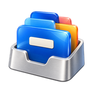</a>

<h1 align="center">Indie Mac Apps List</h1>

<strong>Discover thoughtful software for your Mac.</strong> 
20 selected apps. Six categories. A useful place to start.

<a href="https://indiemacapps.com/?utm_source=github&utm_medium=referral&utm_campaign=indie_mac_apps_list"><strong>Explore the website</strong></a> &nbsp;·&nbsp;
<a href="#find-an-app">Browse the list</a> &nbsp;·&nbsp;
<a href="https://indiemacapps.com/submit?utm_source=github&utm_medium=referral&utm_campaign=indie_mac_apps_list">Submit an app</a>

[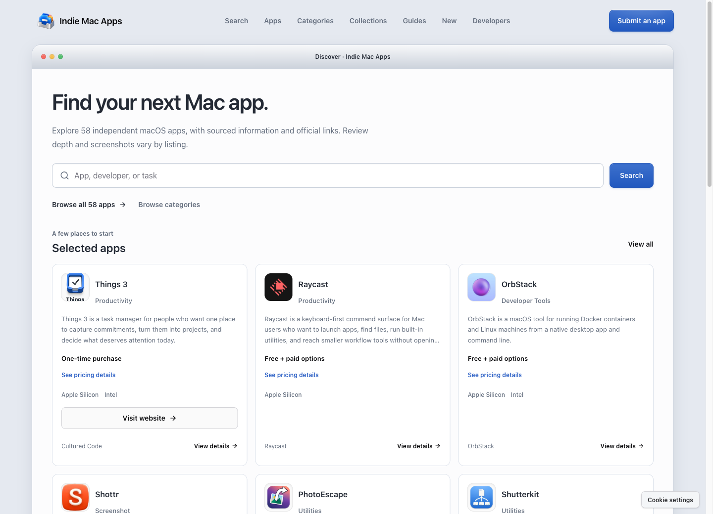](https://indiemacapps.com/?utm_source=github&utm_medium=referral&utm_campaign=indie_mac_apps_list)

A look inside <a href="https://indiemacapps.com/?utm_source=github&utm_medium=referral&utm_campaign=indie_mac_apps_list">indiemacapps.com</a>. The full directory goes beyond this selection.

## Find an app

[Planning & notes](#planning-and-notes) **4** &nbsp;·&nbsp; [Desktop & automation](#desktop-utilities-and-automation) **5** &nbsp;·&nbsp; [Developer tools](#developer-tools) **4** 
[Images, screen & audio](#images-screen-capture-and-audio) **4** &nbsp;·&nbsp; [Text & reading](#text-editing-and-reading) **2** &nbsp;·&nbsp; [Network visibility](#network-visibility) **1**

App names link to official websites. Labels describe the work each app helps with.

### Planning and notes

| App | What it helps with |
| :---: | :--- |
| 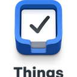 **[Things 3](https://culturedcode.com/things/)** | <code>Tasks</code> <code>Projects</code> Capture tasks, organize projects and plan each day. |
|  **[NotePlan](https://noteplan.co/)** | <code>Daily planning</code> <code>Calendar</code> Bring daily notes, tasks and calendar context together for everyday planning. |
|  **[Bear](https://bear.app/)** | <code>Markdown</code> <code>Notes</code> Write and organize a personal note library with Markdown and tags. |
| 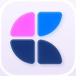 **[Craft](https://www.craft.do/)** | <code>Documents</code> <code>Sharing</code> Draft documents, arrange ideas and share finished material in a document workspace. |

### Desktop utilities and automation

| App | What it helps with |
| :---: | :--- |
|  **[Alfred](https://www.alfredapp.com/)** | <code>Launcher</code> <code>Search</code> Find apps, files and web searches from a keyboard-driven launcher. |
| 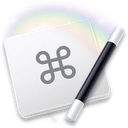 **[Keyboard Maestro](https://www.keyboardmaestro.com/main/)** | <code>Macros</code> <code>Automation</code> Turn repeated desktop tasks into reusable macros. |
| 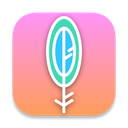 **[Maccy](https://maccy.app/)** | <code>Clipboard</code> <code>Search</code> Search clipboard history and reuse copied items from a keyboard-focused menu. |
| 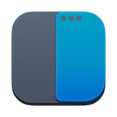 **[Rectangle](https://rectangleapp.com/)** | <code>Windows</code> <code>Shortcuts</code> Arrange windows using keyboard shortcuts and drag-to-snap actions. |
| 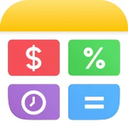 **[Soulver](https://soulver.app/)** | <code>Calculations</code> <code>Scratchpad</code> Work through calculations in a readable, notepad-style scratchpad. |

### Developer tools

| App | What it helps with |
| :---: | :--- |
|  **[Nova](https://nova.app/)** | <code>Code editor</code> <code>Projects</code> Edit source files and work on development projects in a Mac-native editor. |
| 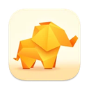 **[TablePlus](https://tableplus.com/)** | <code>Databases</code> Connect to and work with multiple database systems in one desktop client. |
| 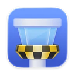 **[Tower](https://www.git-tower.com/mac)** | <code>Git</code> <code>Diffs</code> Review Git working copies, branches and diffs in a visual desktop client. |
|  **[Transmit](https://panic.com/transmit/)** | <code>File transfer</code> <code>Cloud storage</code> Transfer files between a Mac, remote servers and supported cloud storage. |

### Images, screen capture and audio

| App | What it helps with |
| :---: | :--- |
| 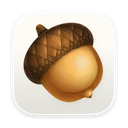 **[Acorn](https://flyingmeat.com/acorn/)** | <code>Image editing</code> <code>Layers</code> Edit images using layers, selections, filters and export controls. |
| 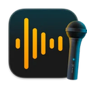 **[Audio Hijack](https://rogueamoeba.com/audiohijack/)** | <code>Audio capture</code> Set up repeatable Mac audio-capture sessions. |
|  **[Screen Studio](https://www.screen.studio/)** | <code>Screen recording</code> <code>Demos</code> Record and edit your screen for product demos and tutorials. |
|  **[Shottr](https://shottr.cc/)** | <code>Screenshots</code> <code>OCR</code> Capture and annotate screenshots, measure details and extract text from images. |

### Text editing and reading

| App | What it helps with |
| :---: | :--- |
| 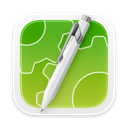 **[CotEditor](https://coteditor.com/)** | <code>Plain text</code> Create and edit plain-text files in a focused macOS editor. |
|  **[NetNewsWire](https://netnewswire.com/)** | <code>RSS</code> <code>Reading</code> Gather RSS feeds into a reading list and keep track of unread items. |

### Network visibility

| App | What it helps with |
| :---: | :--- |
| 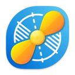 **[Little Snitch](https://www.obdev.at/products/littlesnitch/index.html)** | <code>Network monitor</code> <code>Firewall</code> Inspect application network connections and set rules for handling them. |

## Explore more

The [Indie Mac Apps website](https://indiemacapps.com/?utm_source=github&utm_medium=referral&utm_campaign=indie_mac_apps_list) adds app details, sourced information, comparisons and ways to filter the wider catalog.

- [Browse all apps](https://indiemacapps.com/apps?utm_source=github&utm_medium=referral&utm_campaign=indie_mac_apps_list) — search the full directory.
- [Read the guides](https://indiemacapps.com/guides?utm_source=github&utm_medium=referral&utm_campaign=indie_mac_apps_list) — compare tools and find a workflow that fits.
- [Suggest your app](https://indiemacapps.com/submit?utm_source=github&utm_medium=referral&utm_campaign=indie_mac_apps_list) — free submissions, reviewed before listing.

## Help improve the list

Found a useful app or an outdated detail? [Suggest an app or report a correction](https://github.com/charlessnow/indie-mac-apps-list/issues/new/choose). Developers are welcome to recommend their own work with a relationship disclosure. See the [contribution guide](CONTRIBUTING.md) for details.

Selection notes and image credits

We focus on independently developed Mac software with an identifiable developer, a clear purpose and an official website. “Independent” describes the developer or team; it does not mean “open source.” This is a starting point, not a ranking or an exhaustive catalog.

Descriptions summarize publicly documented functions. Inclusion does not imply hands-on testing or a security audit. Check the official website for current pricing, requirements and availability. GitHub entries and website listings are separate editorial decisions; no reciprocal link or star is required.

The website preview is a real capture of the public Indie Mac Apps homepage. App icons identify their respective products and remain the property of their owners; inclusion does not imply endorsement. Maintained by [Indie Mac Apps](https://indiemacapps.com/?utm_source=github&utm_medium=referral&utm_campaign=indie_mac_apps_list).

